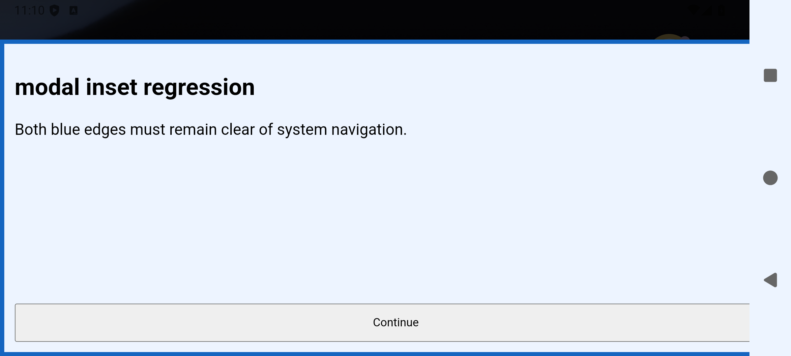
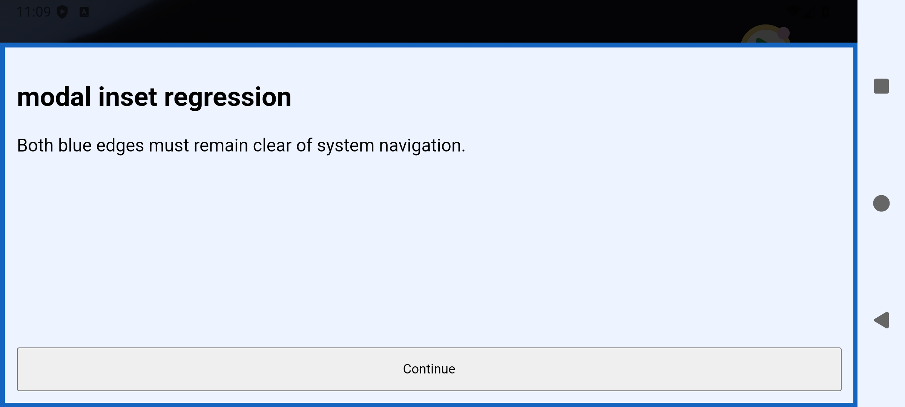
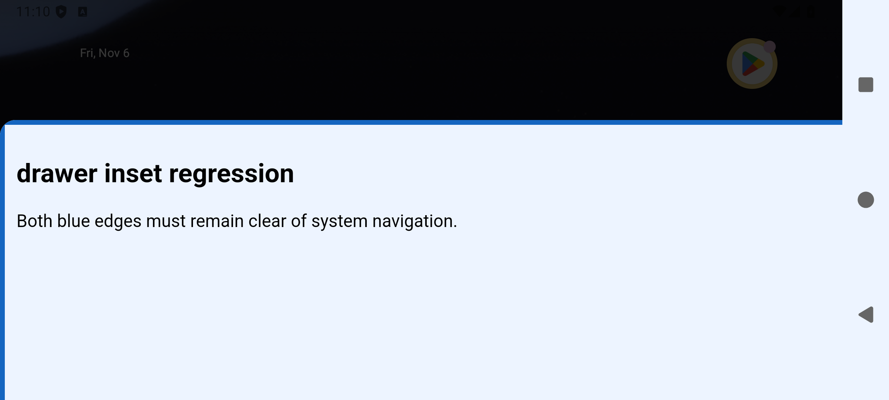
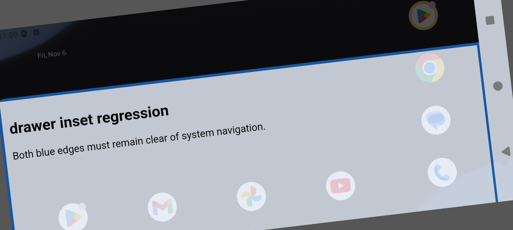
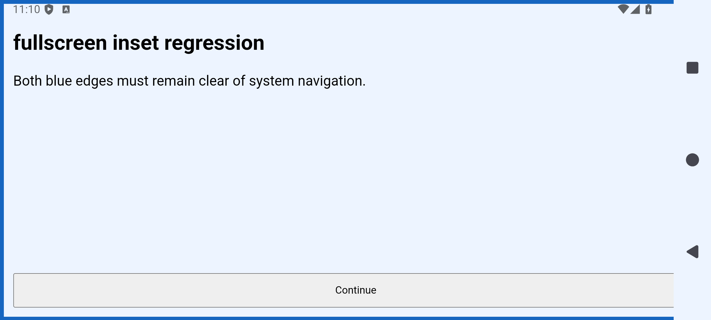
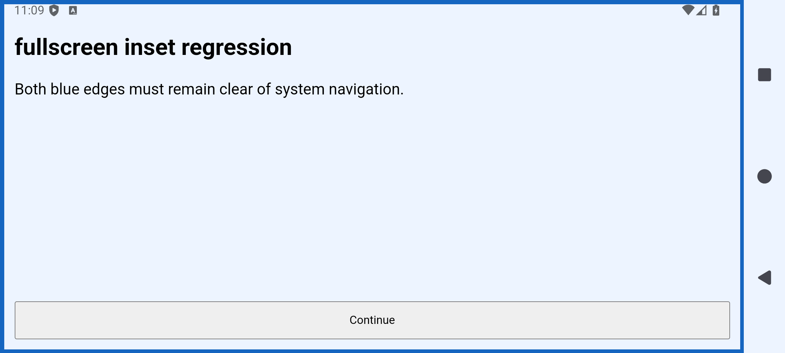

# SW-6374 Android device verification

Android 15 / API 35, Medium Phone emulator, 1080 x 2400.

- Fixed build: four tests passed with gesture navigation; four passed with three-button navigation.
- Every test covers portrait -> landscape -> reverse landscape -> portrait, including repeated inset dispatch and side reset for modal/drawer/fullscreen.
- Three-button landscape reports a 126 px right inset; reverse landscape reports a 126 px left inset. Fixed content stays outside each bar.
- With only the three horizontal-inset assignments removed, modal, drawer and fullscreen tests all fail in landscape: WebView right=2400 while safe right=2274. The same test fixture is used for baseline and fixed builds.
- SDK unit suite: 2,036 tests passed, no failures/skips.

The screenshots show a local HTML fixture in the real SuperwallPaywallActivity and Android WebView, with SDK backend services mocked. They do not exercise a live customer paywall or purchases.

## Landscape comparison (three-button navigation)

| Presentation | Without fix | With fix |
| --- | --- | --- |
| modal |  |  |
| drawer |  |  |
| fullscreen |  |  |
